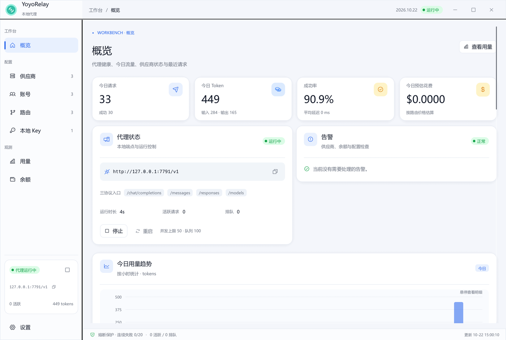
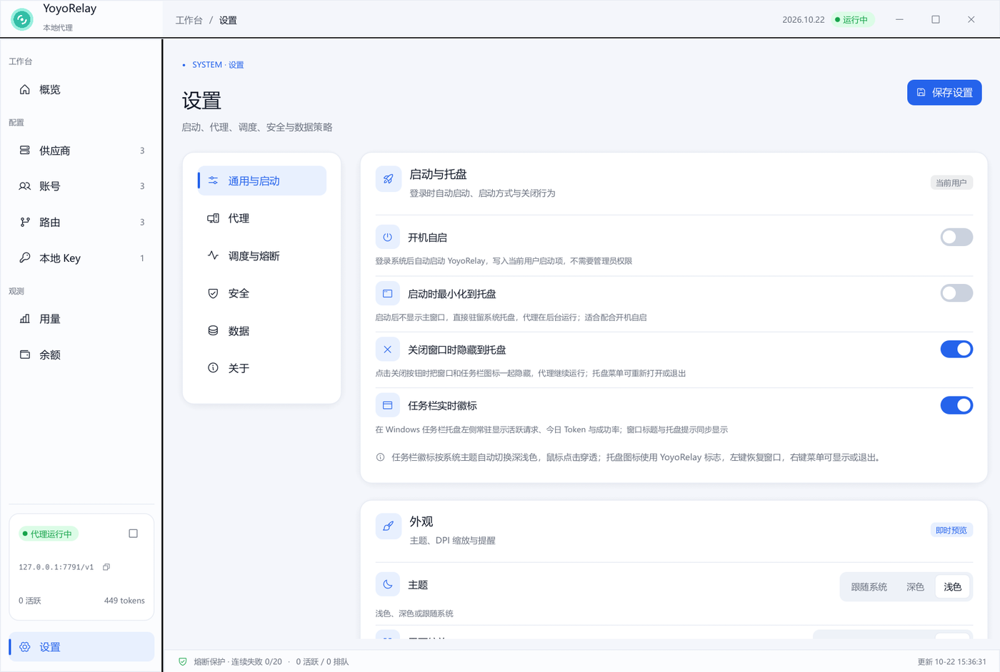

<p align="center">
  
</p>

# YoyoRelay

本地优先的多上游 LLM 代理桌面应用。把多个供应商（官方直连、Command Code、OpenCode Zen、任意自定义端点）下的多个账号聚合成一个本地端点，由调度器完成 **账号级轮询 → 供应商级降级 → 映射级兜底**，并提供中文的额度、余额与用量观测面板。

> Rust + eframe/egui 0.33 + axum + reqwest + SQLite。无 Electron、无 Node 运行时、单二进制。





## 功能

- **三层降级调度**：同供应商账号优先轮询；同供应商无可用账号时切换到下一个供应商；所有映射失败后可显式启用另一套 `fallback_client_model` 映射兜底。
- **账号状态机**：健康 / 冷却（指数退避）/ 半开探测 / 额度用尽 / 手动禁用。并发满的账号只是暂时跳过，不误判为故障。
- **协议转换**：OpenAI Chat Completions、Anthropic Messages、OpenAI Responses 三套协议的请求与 **SSE 流式事件**互转，含工具调用、图片与 usage 提取。
- **四类连接测试**：供应商、账号（含编辑中的草稿 Key 预检）、路由（完整链路预览）、本地 Key（含白名单拒绝校验）。测试请求不写入正式用量。
- **用量与余额**：SQLite 记录请求、Token、延迟、花费；按账号 / 供应商 / 全局 / 客户端模型四维聚合；可交互柱状/面积图；余额支持自动查询、手动录入和不可用三态。
- **本地 Key**：`yr-` 前缀、模型白名单、Token/请求数独立额度、AES-256-GCM 加密存储。
- **安全**：账号 Key 与本地 Key 加密落盘；界面与日志脱敏；请求鉴权；配置导出不含密钥。
- **界面**：无边框自定义标题栏、浅色/深色主题、自动 DPI 缩放、图标按钮、遮罩 + 阴影弹窗、响应式列表（窄窗口切换为图标导航栏）。
- **启动与托盘**：开机自启（Windows 注册表 / macOS LaunchAgent / Linux XDG autostart）、启动时最小化、关闭窗口时最小化到任务栏、任务栏实时请求信息（窗口标题显示活跃请求、今日 Token 与代理状态，悬停任务栏按钮可见）。
- **设置页**：按「通用与启动 / 代理 / 调度与熔断 / 安全 / 数据 / 关于」分区，切换即保存。

## 快速开始

```bash
cargo run --release
```

首次启动会在配置目录生成 `config.json`、`master.key`、`usage.db`，并创建一个默认本地 Key。默认配置目录：

- Windows：`%APPDATA%\YoyoRelay`
- macOS：`~/Library/Application Support/YoyoRelay`
- Linux：`~/.config/YoyoRelay`

也可以设置 `YOYO_RELAY_HOME` 指定独立目录（便于测试/多实例）：

```bash
YOYO_RELAY_HOME=/tmp/yoyo-relay cargo run --release
```

本地端点默认 `http://127.0.0.1:7789`。在「本地 Key」页复制 Key 后：

```bash
curl -N http://127.0.0.1:7789/v1/chat/completions \
  -H "Authorization: Bearer yr-..." \
  -H "Content-Type: application/json" \
  -d '{"model":"gpt-4o","messages":[{"role":"user","content":"hi"}],"stream":true}'
```

Anthropic 客户端可直接指向 `/v1/messages`（使用 `x-api-key` 或 Bearer）；Responses 客户端使用 `/v1/responses`。

## 配置与使用要点

1. **供应商**：选择预设或自定义 Base URL，配置鉴权方式与协议解析策略。聚合平台可用「按模型前缀」规则实时推导上游协议。
2. **账号**：填写 API Key 后可先「测试当前 Key」再保存。额度窗口支持滚动/每日/每周/每月，按本地统计判断是否耗尽。
3. **路由**：同一 `client_model` 下多条路由按 `priority` 降序形成候选链；同供应商多条路由视为同一层。可选填写「映射级兜底」。
4. **本地 Key**：客户端使用；可限制模型白名单与累计额度。
5. **设置**：可调整开机自启、启动/关闭行为、任务栏信息、主题与缩放、全局并发、排队、超时、冷却、熔断、数据保留与导入导出。

### 命令行

```bash
yoyo-relay                 # 图形界面
yoyo-relay --headless      # 仅启动代理，Ctrl+C 退出
yoyo-relay --selftest      # 启动代理并自动跑完四类连接测试后退出
yoyo-relay --page usage    # 指定启动页面（overview/providers/accounts/routes/keys/usage/balances/settings）
yoyo-relay --minimized     # 启动后直接最小化
yoyo-relay --autostart on  # 注册开机自启（off 取消）
```

开机自启也可以在「设置 → 通用与启动」中切换；Windows 写入当前用户 `Run` 注册表项，macOS 写入 `~/Library/LaunchAgents`，Linux 写入 `~/.config/autostart`。

调试构建还支持 `YOYO_RELAY_DEMO=editor|account_editor|route_editor|key_editor|onboarding|test|confirm|pin` 用于直接打开对应界面。

## 分支与发布

- `dev`：日常开发分支，所有功能与修复提交到这里。
- `main`：发布分支，只接受来自 `dev` 的发布合并。
- 只有维护者明确要求发布时，才会更新 `Cargo.toml` 版本号与 `CHANGELOG.md`，然后合并到 `main`。
- `main` 的推送会触发 [Release 工作流](.github/workflows/release.yml)：读取版本号、检查标签、提取 `CHANGELOG.md` 发布说明，并构建 Windows / macOS / Linux 发布包；Windows x64 与 Linux x64 额外提供 UPX 压缩版。
- 仓库初始化提交带有 `[skip release]`，因此不会误触发发布。

完整规则见 [AGENTS.md](AGENTS.md) 与 [CONTRIBUTING.md](CONTRIBUTING.md)。

## 开发与测试

```bash
cargo test
cargo build --release
```

端到端联调可使用内置的模拟上游（同时模拟 OpenAI 与 Anthropic，含流式与错误 Key）：

```bash
python tools/mock_upstream.py 18080
```

然后准备一个测试配置目录，让供应商 URL 指向 `http://127.0.0.1:18080/v1`，运行：

```bash
YOYO_RELAY_HOME=/tmp/yoyo-relay-home cargo run -- --selftest
```

### 模块

| 模块 | 职责 |
|---|---|
| `config/` | 配置模型、schema 迁移、AES-GCM 密钥封装、预设、导入导出 |
| `db.rs` | SQLite 用量、余额、聚合查询、保留策略 |
| `protocol.rs` | 三协议请求/响应转换、SSE 解码与流式翻译 |
| `scheduler.rs` | 账号状态机、候选链、并发槽、配额、熔断 |
| `gateway.rs` | axum 本地端点、鉴权、排队、上游转发、SSE 透传、用量落库 |
| `probe.rs` | 供应商/账号/草稿账号/路由/本地 Key 测试与半开探测 |
| `balance.rs` | 自动余额查询与 JSON 路径提取 |
| `runtime.rs` | 代理生命周期、后台任务、测试任务、UI 快照 |
| `ui/` | 主题、组件库、八个页面、编辑器与弹窗 |

## 性能实测

在开发机（Windows 11、Intel Arc B390、175% DPI、release 构建）上：

| 模式 | 空闲 RSS |
|---|---|
| 仅代理 `--headless` | **11.3 MiB** |
| 图形界面 | 约 **194 MiB** |

图形界面的主要开销来自 eframe/OpenGL 在该环境下的空白窗口基线（实测约 **130 MiB**），其余为 CJK 字体加载与字形纹理（约 50–60 MiB）。因此：

- **代理核心本身远低于 60 MiB 目标**，适合 `--headless` 常驻。
- 在当前 eframe + OpenGL 组合下，**GUI 版本无法达到 60 MiB**。若这是硬性发布条件，需要改用非 OpenGL 的轻量 UI 方案，或在目标机器上重新测量（不同 GPU 驱动的基线差异很大）。

## 已知限制

- **系统托盘未实现**：关闭到托盘目前表现为最小化到任务栏（默认关闭，可在设置中启用）。后续接入 `tray-icon`。
- **任务栏信息**：通过窗口标题与任务栏悬停提示展示，不使用 Windows 任务栏叠加图标或进度条。
- **GUI 内存目标未达标**：见上方“性能实测”。
- **调试报文记录未实现**：`debug_mode` 仅保留开关，不记录请求体/响应体。
- **余额自动查询是通用 JSON 路径方案**：需要供应商提供余额端点；未内置各家私有余额 API 适配。
- **协议转换覆盖聊天场景**：Embeddings 等非聊天请求只支持 `passthrough` 路由（原样透传）。
- **429 子类型判断基于响应文本关键词**：不同供应商的并发/额度限流语义可能存在偏差。
- **macOS 构建未签名**：首次打开需要在系统设置中允许；不提供 UPX 版本（会破坏签名且对 arm64 支持不可靠）。

## 安全说明

- 账号 API Key 与本地 Key 使用 AES-256-GCM 加密；主密钥保存在配置目录的 `master.key`（Unix 下以 `0600` 创建）。
- 日志/界面只显示前 4 后 4 位。
- 配置导出会清空所有密钥；导入后需要重新录入 API Key。
- 默认只监听 `127.0.0.1`，请勿在不可信网络中暴露到公网。
