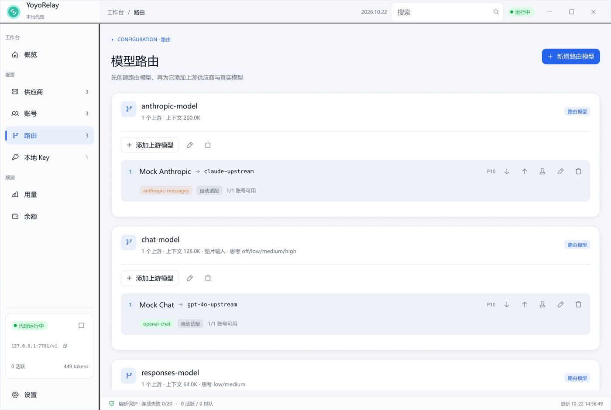
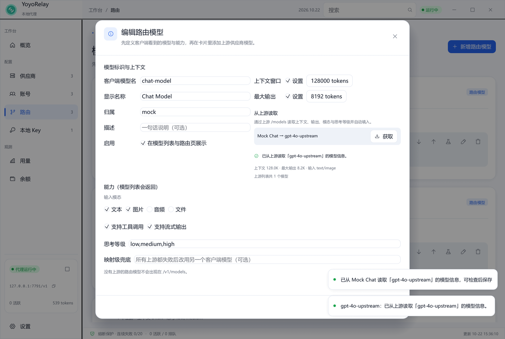

<p align="center">
  
</p>

# YoyoRelay

本地优先的多上游 LLM 代理桌面应用。把多个供应商（官方直连、Command Code、OpenCode Zen、任意自定义端点）下的多个账号聚合成一个本地端点，由调度器完成 **账号级轮询 → 供应商级降级 → 映射级兜底**，并提供中文的额度、余额与用量观测面板。

> Rust + eframe/egui 0.33 + axum + reqwest + SQLite。无 Electron、无 Node 运行时、单二进制。







## 功能

- **三层降级调度**：同供应商账号优先轮询；同供应商无可用账号时切换到下一个供应商；所有映射失败后可显式启用另一套 `fallback_client_model` 映射兜底。
- **账号状态机**：健康 / 冷却（指数退避）/ 半开探测 / 额度用尽 / 手动禁用。并发满的账号只是暂时跳过，不误判为故障。
- **协议转换与直通**：OpenAI Chat Completions、Anthropic Messages、OpenAI Responses 三套协议 **9 种入口/上游组合** 全部支持（含 SSE 流式事件、工具调用、图片与 usage 提取）；客户端协议与上游一致时原样直通，不一致才转换。新增「跟随调用方（直通）」策略，可让同一供应商同时服务三种协议。
- **模型列表**：`GET /v1/models` 同时兼容 OpenAI 与 Anthropic 列表结构，并返回上下文窗口、最大输出、输入模态（文本/图片/音频/文件）、工具/流式能力与思考等级，便于第三方工具直接拉取。
- **连接测试与测速**：供应商、账号（含编辑中的草稿 Key 预检）、路由（完整链路预览）、本地 Key（含白名单拒绝校验）四类连接测试；供应商与账号另有流式测速，按真实生成过程统计 tokens/秒、首字延迟与生成 token 数（供应商测速会依次覆盖旗下全部启用账号）。测试请求不写入正式用量。
- **用量与余额**：SQLite 记录请求、Token、延迟、花费；按账号 / 供应商 / 全局 / 客户端模型四维聚合；可交互柱状/面积图；余额支持自动查询、手动录入和不可用三态，余额页可直接编辑查询 URL、JSON 路径、公式与倍率，并提供「总额度 × (100 − 已用%)」百分比换算。**CNY 与 USD 等不同币种分别统计，不直接相加**，并按币种设置低余额阈值与汇率。
- **调用明细**：独立分页页面展示最近 1000 条请求（每页 20 条），含模型/上游映射、供应商/账号、输入/缓存命中/输出/总 token、金额、耗时与状态，支持筛选、单条删除与一键清空；概览最近请求同步展示这些字段。
- **本地 Key**：`yr-` 前缀、模型白名单、Token/请求数独立额度、AES-256-GCM 加密存储。
- **安全**：账号 Key 与本地 Key 加密落盘；界面与日志脱敏；请求鉴权；配置导出不含密钥。
- **界面**：无边框自定义标题栏、浅色/深色主题、自动 DPI 缩放、图标按钮、遮罩 + 阴影弹窗、响应式列表（窄窗口切换为图标导航栏）。
- **路由模型**：先创建一个客户端路由模型并定义上下文、最大输出、图片/文本能力、思考等级与兜底，再在模型卡片里逐条添加上游供应商与真实模型，按优先级组成降级链。编辑模型时可点「获取」直接通过上游 `/models` 读取上下文与能力并自动填入。
- **启动、托盘与单实例**：开机自启（Windows 注册表 / macOS LaunchAgent / Linux XDG autostart）；启动时直接驻留系统托盘；关闭窗口隐藏到托盘（Windows 上窗口与任务栏按钮一起消失，代理继续运行）；**托盘提示与右键菜单实时显示活跃请求、今日 Token、队列、成功率与端点**；托盘图标使用应用 Logo，左键恢复主窗口；重复启动程序会直接唤出已有窗口并置于前台，不会报错或启动第二个实例。
- **任务栏实时徽标**：Windows 下在托盘左侧的任务栏区域常驻一枚原生徽标，可组合显示代理状态、活跃请求、今日 Token、请求数、队列、成功率、预估花费与**实时 tok/s**；支持缩放、偏移、不透明度、**透明底色**与**自定义文字颜色**，点击穿透，不占用任务栏按钮。
- **更新检查与自动更新**：标题栏检查按钮与红点提示，按间隔自动检查 GitHub Release；发现新版本时弹窗展示发布说明。「立即更新」会自动选择当前平台的发布包，校验大小与 SHA-256（Release 提供时），解压并替换当前程序，完成后自动重启；失败会保留原程序并提供重试/Release 页面回退。
- **计费价格**：每个上游可单独设置计价币种（**USD / CNY**）、输入价、**输入缓存命中价**与输出价，并支持**峰谷时段**：默认价用于未命中任何时段的时间（通常填低谷/空闲价），只需添加高峰时段，跨午夜自动处理；新增工作日/夜间高峰快捷预设。还可点「AI 生成」，用中文描述需求让当前路由的上游模型生成价格方案并预览应用。所有花费按实时汇率折算为 USD 统计，币种只影响录入与展示口径。
- **价格方案库**：把价格表存为可复用方案，在任意上游一键套用；方案可单独导出/导入为 JSON（不含任何账号或 Key），便于跨机器与团队共享。
- **JS 插件系统**：基于 Boa 0.22 的 ES Module 插件，每个插件运行在独立线程与独立 JS `Context` 中，支持动态加载、启用/禁用、卸载与重载。生命周期事件包括启动、启用、禁用、卸载，以及 `beforeRequest`（可修改请求体或直接拦截）、`afterResponse`（修改非流式响应）、`onRequestCompleted`、`onAccountFailure` 等。宿主封装了日志、沙箱文件系统、异步 HTTP/SSE、**WebSocket 客户端与服务端**、SHA-256/HMAC/AES-GCM、Base64/URL/Hex 编码、受控进程调用、持久键值存储、时间/UUID，以及 toast/confirm/prompt/alert 界面交互。插件还可以导出 `providers`，自动生成**临时供应商 + 虚拟账号 + 路由**，通过 `onProviderRequest` 接入自己的模型服务（支持 SSE 流式转发）；实现 `onListModels()` 可动态刷新模型列表；卸载或禁用插件时这些条目自动移除，不写入用户配置。插件页内置 API 文档、运行日志控制台（图标按钮，保留最新 500 条）、自检与示例安装，并可下载面向编码代理的插件开发 Skill。插件目录为 `<配置目录>/plugins`，数据目录为 `plugin-data/<id>`。详见 [docs/plugins.md](docs/plugins.md)。
- **局域网访问**：「代理」设置新增「允许局域网访问」开关（监听 `0.0.0.0`）；开启后设置页、概览与侧边栏会列出本机与各网卡的 Base URL，可一键复制。若监听所有网卡但仍关闭本地鉴权，会显示醒目警告。
- **设置页**：按「通用与启动 / 任务栏徽标 / 代理 / 调度与熔断 / 计费价格 / 安全 / 数据 / 关于」分区，切换即保存。插件权限（网络、进程）在「插件」页配置。

## 快速开始

```bash
cargo run --release
```

首次启动会在配置目录生成 `config.json`、`master.key`、`usage.db`，并创建一个默认本地 Key。默认配置目录：

- Windows：`%APPDATA%\YoyoRelay`
- macOS：`~/Library/Application Support/YoyoRelay`
- Linux：`~/.config/YoyoRelay`

调试构建（`cargo run` / `cargo build`）与安装版完全隔离：使用 `YoyoRelay-dev` 配置目录、默认端口 `17789`、独立的自启项与单实例锁，窗口标题为「YoyoRelay Dev」。因此可以同时运行开发版和正式版，开发版不会关闭或劫持正式版的窗口。

也可以设置 `YOYO_RELAY_HOME` 指定独立目录（便于测试/多实例）：

```bash
YOYO_RELAY_HOME=/tmp/yoyo-relay cargo run --release
```

本地 API Base URL 默认是 `http://127.0.0.1:7789/v1`（包含 `/v1`）。OpenAI、Anthropic 与 Responses 客户端都填这一地址。在「本地 Key」页复制 Key 后：

```bash
curl -N http://127.0.0.1:7789/v1/chat/completions \
  -H "Authorization: Bearer yr-..." \
  -H "Content-Type: application/json" \
  -d '{"model":"gpt-4o","messages":[{"role":"user","content":"hi"}],"stream":true}'
```

Anthropic 客户端使用 `http://127.0.0.1:7789/v1/messages`（`x-api-key` 或 Bearer）；Responses 客户端使用 `/v1/responses`；模型列表为 `GET /v1/models`。

## 配置与使用要点

1. **供应商**：选择预设或自定义 Base URL，配置鉴权方式与协议解析策略。聚合平台可用「按模型前缀」规则实时推导上游协议。
2. **账号**：填写 API Key 后可先「测试当前 Key」再保存。额度窗口支持滚动/每日/每周/每月，按本地统计判断是否耗尽。
3. **路由模型**：先在「模型路由」页创建客户端模型并填写上下文窗口、最大输出、输入模态、思考等级与映射级兜底；再在模型卡片里添加一条或多条上游（供应商 + 真实模型），按 `priority` 降序形成候选链，同供应商多条上游视为同一层。
4. **本地 Key**：客户端使用；可限制模型白名单与累计额度。
5. **设置**：可调整开机自启、启动/关闭行为、任务栏徽标（含实时 tok/s、透明底色与文字颜色）、主题与缩放、全局并发、排队、超时、冷却、熔断、计费价格方案、更新检查、数据保留与导入导出。
6. **插件**：在「插件」页安装示例或把插件目录放到配置目录的 `plugins/` 下，重新扫描后即可启用。`beforeRequest` 可以修改模型/请求体或直接返回拦截响应；插件网络与进程权限可单独开关。

### 命令行

```bash
yoyo-relay                 # 图形界面
yoyo-relay --headless      # 仅启动代理，Ctrl+C 退出
yoyo-relay --selftest      # 启动代理并自动跑完四类连接测试后退出
yoyo-relay --page usage    # 指定启动页面（overview/providers/accounts/routes/keys/usage/balances/settings）
yoyo-relay --minimized     # 启动后直接隐藏到系统托盘
yoyo-relay --autostart on  # 注册开机自启（off 取消）
```

重复运行 `yoyo-relay` 不会启动第二个实例：程序会通过本机控制通道唤出正在运行的窗口（隐藏到托盘时也会恢复并置前），然后立即退出。

开机自启也可以在「设置 → 通用与启动」中切换；Windows 写入当前用户 `Run` 注册表项，macOS 写入 `~/Library/LaunchAgents`，Linux 写入 `~/.config/autostart`。

调试构建还支持 `YOYO_RELAY_DEMO=editor|account_editor|route_editor|key_editor|onboarding|test|confirm|pin` 用于直接打开对应界面。

## 分支与发布

- `dev`：日常开发分支，所有功能与修复提交到这里。
- `main`：发布分支，只接受来自 `dev` 的发布合并。
- 只有维护者明确要求发布时，才会更新 `Cargo.toml` 版本号与 `CHANGELOG.md`，然后合并到 `main`。
- `main` 的推送会触发 [Release 工作流](.github/workflows/release.yml)：读取版本号、检查标签、提取 `CHANGELOG.md` 发布说明，并构建 Windows / macOS / Linux 发布包；Windows x64 与 Linux x64 额外提供 UPX 压缩版。
- 仓库初始化提交带有 `[skip release]`，因此不会误触发发布。

完整规则见 [AGENTS.md](AGENTS.md) 与 [CONTRIBUTING.md](CONTRIBUTING.md)。

## 开发与测试

```bash
cargo test
cargo build --release
```

端到端联调可使用内置的模拟上游（同时模拟 OpenAI 与 Anthropic，含流式与错误 Key）：

```bash
python tools/mock_upstream.py 18080
```

然后准备一个测试配置目录，让供应商 URL 指向 `http://127.0.0.1:18080/v1`，运行：

```bash
YOYO_RELAY_HOME=/tmp/yoyo-relay-home cargo run -- --selftest
```

### 模块

| 模块 | 职责 |
|---|---|
| `config/` | 配置模型、schema 迁移、AES-GCM 密钥封装、预设、导入导出 |
| `db.rs` | SQLite 用量、余额、聚合查询、保留策略 |
| `protocol.rs` | 三协议请求/响应转换、SSE 解码与流式翻译 |
| `scheduler.rs` | 账号状态机、候选链、并发槽、配额、熔断 |
| `gateway.rs` | axum 本地端点、鉴权、排队、上游转发、SSE 透传、用量落库 |
| `probe.rs` | 供应商/账号/草稿账号/路由/本地 Key 测试与半开探测 |
| `balance.rs` | 自动余额查询与 JSON 路径提取 |
| `runtime.rs` | 代理生命周期、后台任务、测试任务、UI 快照 |
| `instance.rs` | 单实例锁、本机控制通道、窗口显示/退出信号 |
| `tray.rs` | 系统托盘图标与菜单（Logo 图标） |
| `ui/` | 主题、组件库、八个页面、编辑器与弹窗 |

## 性能实测

在开发机（Windows 11、Intel Arc B390、175% DPI、release 构建）上：

| 模式 | 空闲 RSS |
|---|---|
| 仅代理 `--headless` | **11.3 MiB** |
| 图形界面 | 约 **194 MiB** |

图形界面的主要开销来自 eframe/OpenGL 在该环境下的空白窗口基线（实测约 **130 MiB**），其余为 CJK 字体加载与字形纹理（约 50–60 MiB）。因此：

- **代理核心本身远低于 60 MiB 目标**，适合 `--headless` 常驻。
- 在当前 eframe + OpenGL 组合下，**GUI 版本无法达到 60 MiB**。若这是硬性发布条件，需要改用非 OpenGL 的轻量 UI 方案，或在目标机器上重新测量（不同 GPU 驱动的基线差异很大）。

## 已知限制

- **托盘隐藏的平台差异**：Windows 上关闭窗口会连同任务栏按钮一起隐藏到托盘，并可从托盘或再次启动程序恢复；macOS / Linux 的关闭按钮目前回退为最小化到任务栏（托盘图标与“退出”菜单仍可用），原生隐藏/恢复待后续版本完善。
- **托盘图标可能位于 Windows 的隐藏图标区**：Windows 11 默认把新托盘图标收进「^」溢出菜单，可在系统设置中把它拖到任务栏常显。
- **任务栏实时徽标仅 Windows**：以原生分层窗口绘制在托盘左侧，要求横向（底部/顶部）任务栏；竖向任务栏或其它平台继续使用窗口标题与托盘提示。实时 tok/s 为最近约 3 秒的生成速率（流式按字符估算、结束后按上游 usage 校准），空闲 2 秒后归零。
- **CNY 计价按实时汇率折算**：USD 是统计基准，切换汇率不会回写历史花费；峰谷时段按本机时区判断，命中多个时段时以列表顺序中先匹配者为准。
- **插件运行在独立线程**：Boa 解释执行速度低于 V8，适合低频事件与轻量逻辑；`beforeRequest` / `afterResponse` 每个插件最多等待 3 秒。流式响应不会触发 `afterResponse`。进程调用默认关闭，只应对可信插件开启。完整 API 见 [docs/plugins.md](docs/plugins.md)。
- **任务栏徽标的位置依赖系统托盘区域**：Windows 任务栏布局变化后最多 2 秒内重新定位；极端自定义任务栏可能不显示。
- **`--headless` 与图形界面共用单实例锁**：headless 运行期间再次启动程序会直接退出，不会启动第二个代理，也不会弹出窗口。
- **Linux 托盘依赖桌面宿主**：GNOME 需要安装 AppIndicator / KStatusNotifierItem 扩展才能看到托盘图标。
- **GUI 内存目标未达标**：见上方“性能实测”。
- **调试报文记录未实现**：`debug_mode` 仅保留开关，不记录请求体/响应体。
- **余额自动查询是通用 JSON 路径方案**：需要供应商提供余额端点；未内置各家私有余额 API 适配。
- **汇率需要手动维护**：不同币种余额分开统计；手动余额按 USD 计价的花费折算时会使用设置中的汇率，汇率过期会导致估算偏差。
- **模型元数据是本地填写**：上下文窗口、最大输出、模态与思考等级由路由模型配置提供，不会自动探测上游能力。
- **协议转换覆盖聊天场景**：Embeddings 等非聊天请求只支持 `passthrough` 路由（原样透传）。
- **429 子类型判断基于响应文本关键词**：不同供应商的并发/额度限流语义可能存在偏差。
- **macOS 构建未签名**：首次打开需要在系统设置中允许；不提供 UPX 版本（会破坏签名且对 arm64 支持不可靠）。

## 安全说明

- 账号 API Key 与本地 Key 使用 AES-256-GCM 加密；主密钥保存在配置目录的 `master.key`（Unix 下以 `0600` 创建）。
- 日志/界面只显示前 4 后 4 位。
- 配置导出会清空所有密钥；导入后需要重新录入 API Key。
- 默认只监听 `127.0.0.1`，请勿在不可信网络中暴露到公网。
